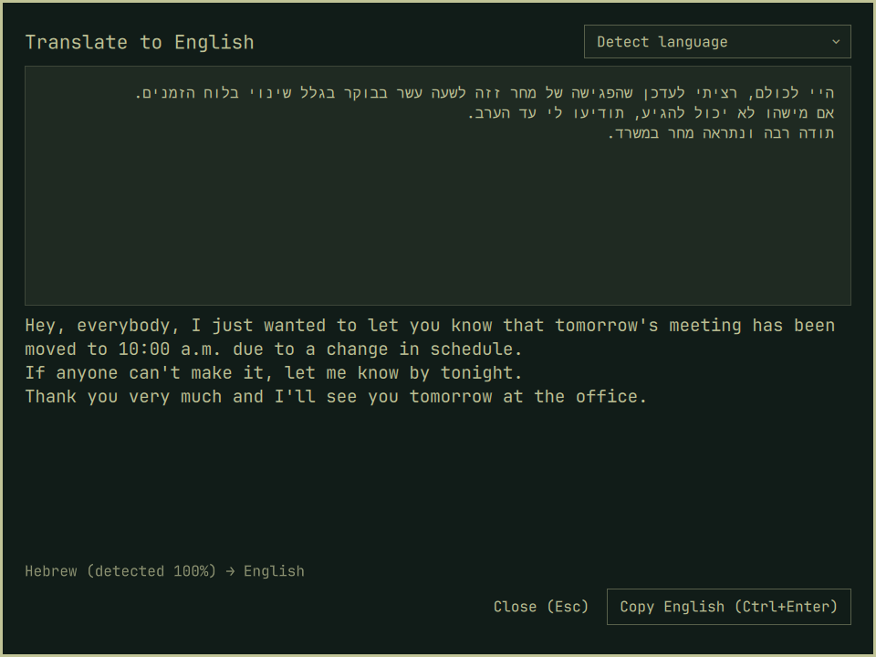

# Offline Translate for Omarchy

Translate text from about 115 languages to English **on your own computer**
with Meta's [NLLB-200](https://ai.meta.com/research/no-language-left-behind/)
model. Nothing is sent to a server.

Quickshell plugin for **Omarchy 4**.




- **Copy popup:** copy non-English text anywhere and a notification shows the
  English translation, with **Copy English** and **Open in Translate**.
- **Translator overlay:** paste text and it detects the language and
  translates as you paste. You can override the detected language.
- **Model only in RAM while in use:** the model loads on the first
  translation and unloads after 2 minutes idle. In between, nothing runs
  except a tiny `wl-paste` watcher. Each copy costs about 70 ms of language
  detection (fastText, 1 MB).

## Install

```bash
omarchy plugin add https://github.com/Lekonidus/omarchy-offline-translate.git --enable
```

Then click the bar icon (󰗊) and choose **Run setup in a terminal**, or run:

```bash
~/.config/omarchy/plugins/io.github.lekonidus.offline-translate/bin/offline-translate setup
```

Setup creates a Python venv in `~/.local/share/omarchy-offline-translate/`
(pinned `ctranslate2`, `tokenizers`, `fasttext-predict`, `numpy`, `jeepney`) and
downloads, checksum-verified:

| File | Size | RAM while loaded |
|---|---|---|
| fastText `lid.176.ftz` (language ID) | 1 MB | — |
| NLLB-200 distilled 1.3B, int8 (default) | 1.4 GB | ~1.6 GB |
| NLLB-200 3.3B, int8 (optional: `setup 3.3B`) | 3.3 GB | ~3.6 GB |

A translation takes about 0.5 s when the model is loaded and about 2 s
from cold on a modern CPU.

### Keybinding (optional)

The plugin doesn't touch your Hyprland config. To open the translator with a
key, add to `~/.config/hypr/bindings.conf`:

```
bindd = SUPER CTRL, T, Translate, exec, omarchy-shell shell toggle io.github.lekonidus.offline-translate '{}'
```

## Use

- **Bar icon:** left-click opens the translator, right-click turns copy
  popups on/off, middle-click unloads the model now. The icon is highlighted
  while the model is in RAM. When popups are off it's dimmed.
- **Overlay:** `Ctrl+V` to paste, `Ctrl+Enter` copies the English and closes,
  `Esc` closes. Use the language picker when detection guesses wrong (short
  text, names, mixed languages).
- **Popups** skip English, very short Latin-script snippets, URLs and paths,
  clipboard over 20,000 characters, and anything a password manager marks as
  secret (`x-kde-passwordManagerHint`).

## Configure

`~/.config/omarchy-offline-translate/config.json` (all optional):

```json
{
  "model": "1.3B",
  "modelDir": "",
  "idleSeconds": 120,
  "clipboardPopups": true,
  "minConfidence": 0.5
}
```

- `modelDir` points at an existing CTranslate2 NLLB model directory instead
  of the downloaded one. It must contain `model.bin`, `config.json`,
  `shared_vocabulary.json` and `tokenizer.json`.
- `idleSeconds` sets how long the model stays loaded after the last
  translation. The minimum is 5.

## Update

```bash
omarchy plugin update io.github.lekonidus.offline-translate
~/.config/omarchy/plugins/io.github.lekonidus.offline-translate/bin/offline-translate setup
```

Re-running `setup` installs any new pinned packages (1.0.1 added `jeepney`).
Models already downloaded are verified, not fetched again. Then run
`omarchy restart shell`: the shell's hot reload can keep the old QML running.

## Remove

```bash
omarchy plugin remove io.github.lekonidus.offline-translate --yes
rm -rf ~/.local/share/omarchy-offline-translate ~/.config/omarchy-offline-translate
```

## Privacy

Copied text is read by the local helper to detect its language. It is never
written to disk or logged. Only a SHA-256 of the last popup's text is kept,
in `$XDG_RUNTIME_DIR`, to avoid duplicate popups. The model server listens
on a Unix socket in a `0700` runtime directory. Network access happens only
during `setup`.

Copied and translated text never appears in process arguments, which other
local users can read through `/proc/<pid>/cmdline`:

- Popups are sent over D-Bus from inside the helper, not through `notify-send`.
- Text reaches `wl-copy` and the helper on stdin.
- **Open in Translate** passes the text to the overlay through a `0600` file in
  the runtime directory, which the overlay deletes once it has read it.

## Dependencies

- Omarchy 4 (`schemaVersion: 1` plugin API), `wl-clipboard`, `notify-send`
- Python 3.10+ with `venv` (the distro Python is preferred for wheel availability)
- About 1.5 GB disk for the default model

## Tests

```bash
tests/run_all.sh
```

## License

The plugin code is MIT. The models are downloaded from their publishers and
are **not** covered by this license:

- NLLB-200 (Meta, converted to CTranslate2 by OpenNMT):
  [CC-BY-NC 4.0](https://creativecommons.org/licenses/by-nc/4.0/), for
  non-commercial use only.
- fastText `lid.176` (Meta):
  [CC-BY-SA 3.0](https://creativecommons.org/licenses/by-sa/3.0/).
